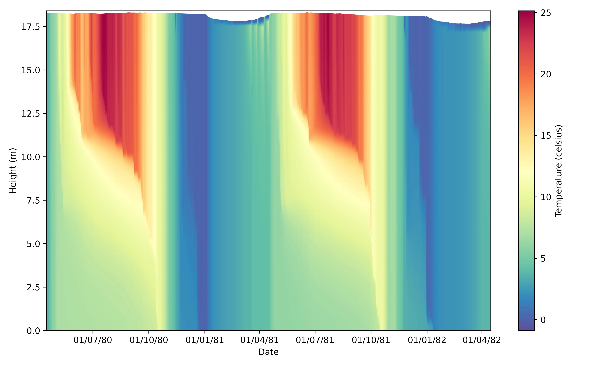
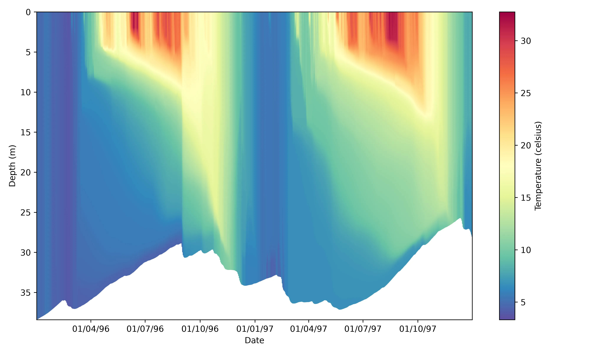
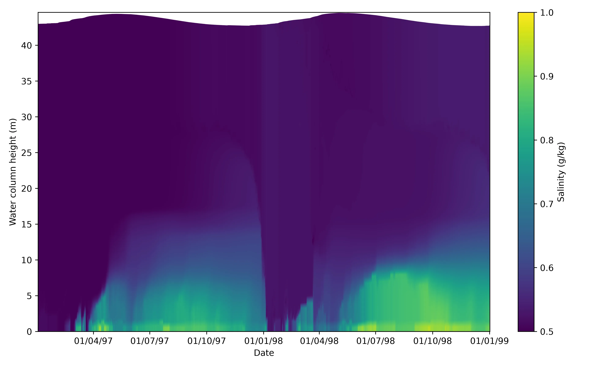
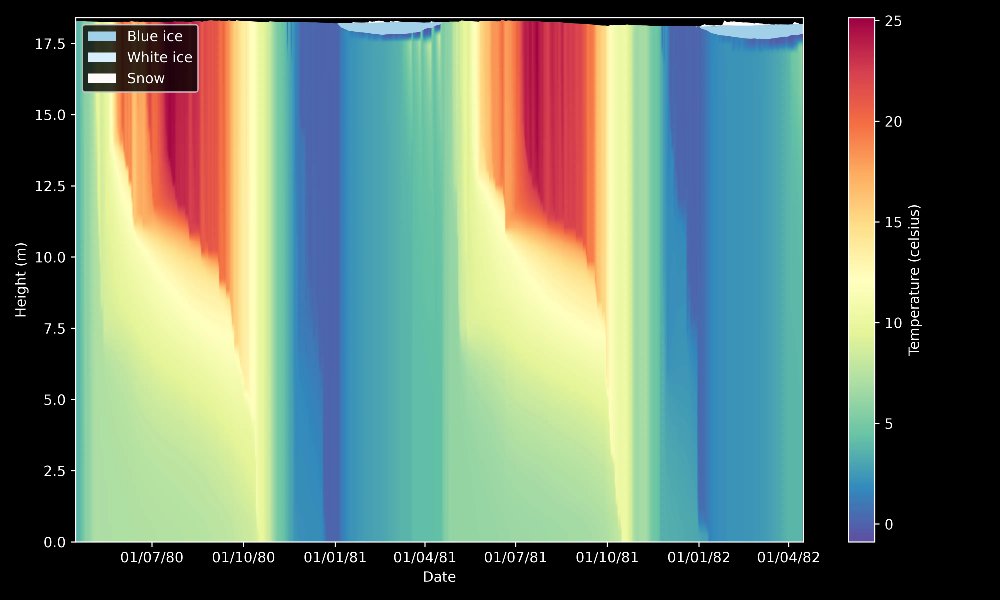

# Plots module

## Approach

glm-py's `plots` module provides a series of classes for creating Matplotlib plots of GLM's various output files:  `LakePlotter` for plotting the lake.csv, `WQPlotter` for plotting the depth-specific WQ_*.csv files, and`NCPlotter` for plotting the output.nc.
The responsibility of each class is strictly to plot the data and its neccesary labels to a Matplotlib `Axes` object with some sensible defaults.
Everything else—the `Figure` and `Axes` creation, adding legends, customising the symbology and labels (including changing the sensible defaults), and exporting the plot—is left to the user.
This approach provides control for the most opinionated part of plot making—it's presentation—while abstracting away the least—getting the data onto the plot.

## Plotting NetCDF outputs

### Plotting profiles

The `plot_profile` method plots a specified variable for every timestep and depth in the NetCDF.
Call it by providing the Matplotlib `Axes` object you wish to plot to, and the desired variable name.

!!! tip "Tip"
    A list of valid variable names can be returned by calling the `get_var_names` method.

```python
import matplotlib.pyplot as plt

from glmpy import plots, simulation


outputs = simulation.GLMSim.from_example_sim('sparkling_lake').run()
nc = plots.NCPlotter(outputs.get_netcdf_path())

fig, ax = plt.subplots(figsize=(10, 6))

profile = nc.plot_profile(ax, 'temp')

fig.colorbar(profile).set_label('Temperature (celsius)')

plt.tight_layout()
```



#### Changing the vertical reference

By default, `plot_profile` measures the water column from the bottom up. 
You can invert this by setting `reference='surface'`.

```python
import matplotlib.pyplot as plt

from glmpy import plots, simulation


outputs = simulation.GLMSim.from_example_sim('grosse_dhuenn').run()
nc = plots.NCPlotter(outputs.get_netcdf_path())

fig, ax = plt.subplots(figsize=(10, 6))

profile = nc.plot_profile(ax, 'temp', reference='surface')

fig.colorbar(profile).set_label('Temperature (celsius)')

plt.tight_layout()
```



#### Customisation

`plot_profile` makes its visualisation using Matplotlib's `imshow` method.
You can customise this call to `imshow` by passing valid parameters to `plot_profile`'s `param_dict`.
Refer to Matplotlib's [`imshow` documentation](https://matplotlib.org/stable/api/_as_gen/matplotlib.pyplot.imshow.html) for information on valid parameters.

!!! tip "Tip"
    `get_units` and `get_long_name` are very helpful for plot automation!
    
```python
import matplotlib.pyplot as plt

from glmpy import plots, simulation


outputs = simulation.GLMSim.from_example_sim('warm_lake').run()
nc = plots.NCPlotter(outputs.get_netcdf_path())

fig, ax = plt.subplots(figsize=(10, 6))

profile = nc.plot_profile(
    ax,
    'salt',
    param_dict={'cmap': 'viridis', 'vmin': 0.5, 'vmax': 1}
)

units = nc.get_units('salt')
long_name = nc.get_long_name('salt').capitalize()
fig.colorbar(profile).set_label(f'{long_name} ({units})')

plt.tight_layout()
```



#### Plotting profiles with snow and ice

Some GLM simulations (such as Sparkling Lake) model the formation of snow and ice on the waterbody's surface.
You can visualise this on a profile plot by calling `plot_snow_ice_profile`.

!!! note "Note"
    The default colours assigned to the ice and snow contrast best on a dark background (see `plt.style.use('dark_background')`). 
    This can of course by customised with the `param_dict` parameters (one for blue ice, white ice, and snow) that modify the underlying Matplotlib call (in this case to `fill_between`). 

```python
import matplotlib.pyplot as plt

from glmpy import plots, simulation


outputs = simulation.GLMSim.from_example_sim('sparkling_lake').run()
nc = plots.NCPlotter(outputs.get_netcdf_path())

plt.style.use('dark_background')
fig, ax = plt.subplots(figsize=(10, 6))

profile = nc.plot_profile(ax, 'temp')
snow_ice = nc.plot_snow_ice_profile(ax)

ax.legend(handles=snow_ice)
fig.colorbar(profile).set_label('Temperature (celsius)')

plt.tight_layout()
```


## Advanced

### Animating profiles and cross-section

```python
import numpy as np
import xarray as xr
import pandas as pd
import matplotlib.pyplot as plt
import matplotlib.dates as mdates
import matplotlib.animation as animation
from matplotlib.colors import ListedColormap

from glmpy import plots, simulation
from tqdm import tqdm


plt.style.use('dark_background')  # black backgrounds, white text/ticks/spines

nc = plots.NCPlotter('dev/sims/sparkling_lake/output/output.nc')
nc.resolution = 0.01

fig, axs = plt.subplot_mosaic(
    [["profile", "profile", "xsection"],
     ["cbar",    "cbar",    "ice"]],
    width_ratios=[1, 1, 1],
    height_ratios=[1, 0.05],
    figsize=(16, 9),
)

# profile panel, with a vline marking the current timestep
profile = nc.plot_profile(axs['profile'], 'temp', 'bottom', {'vmin': 0, 'vmax': 30})
fills = nc.plot_snow_ice_profile(axs['profile'], 'bottom')
x_dates = mdates.date2num(nc._time)
vline = axs['profile'].axvline(x_dates[0], color='white', lw=1)

# cross-section panel
nc.plot_morphometry(
    axs['xsection'],
    curve_param_dict={'color': 'darkgrey'},
    fill_param_dict={'color': 'darkgrey'}
)
img = nc.plot_cross_section(axs['xsection'], 'temp', 0, {'vmin': 0, 'vmax': 30})
ice = nc.plot_snow_ice_cross_section(axs['xsection'], 0)
# match the profile's height range and keep it fixed while frames redraw
axs['xsection'].set_ylim(axs['profile'].get_ylim())
axs['xsection'].get_yaxis().set_visible(False)
# colorbar and horizontal snow/ice legend along the bottom row
colbar = fig.colorbar(profile, cax=axs['cbar'], orientation='horizontal')
colbar.set_label("Temperature (celsius)")
axs['ice'].legend(handles=fills, loc='center', ncol=len(fills), frameon=False)
axs['ice'].axis('off')

plt.tight_layout(rect=(0.0, 0.15, 1.0, 0.85))


def update(frame):
    global img, ice
    img.remove()
    for fill in ice:
        fill.remove()
    img = nc.plot_cross_section(axs['xsection'], 'temp', frame, {'vmin': 0, 'vmax': 30})
    ice = nc.plot_snow_ice_cross_section(axs['xsection'], frame)
    vline.set_xdata([x_dates[frame], x_dates[frame]])
    return [img, *ice, vline]

ani = animation.FuncAnimation(fig=fig, func=update, frames=nc._n_timesteps, interval=1)
writer = animation.FFMpegWriter(fps=60, bitrate=1800)
with tqdm(total=nc._n_timesteps, desc='Rendering') as pbar:
    ani.save('sparkling-lake-animation.mp4', writer, progress_callback=lambda i, n: pbar.update(1))

```


